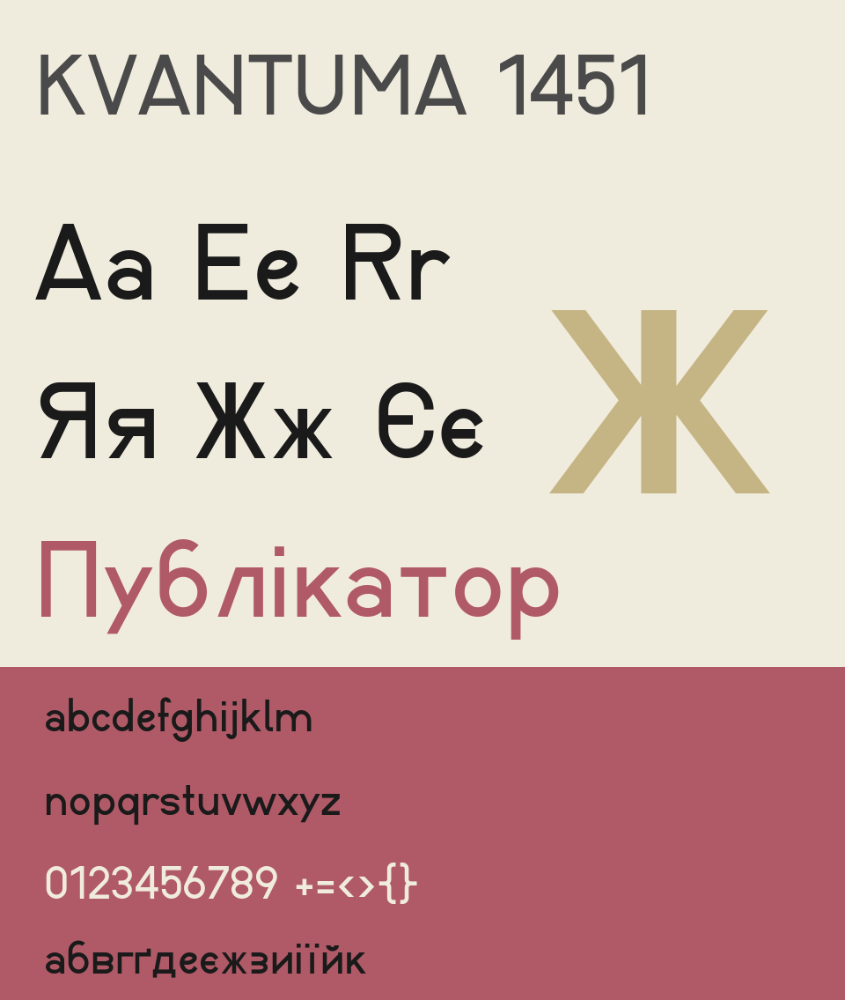
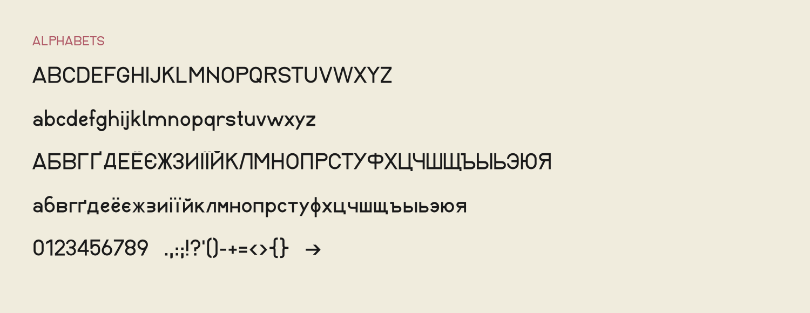
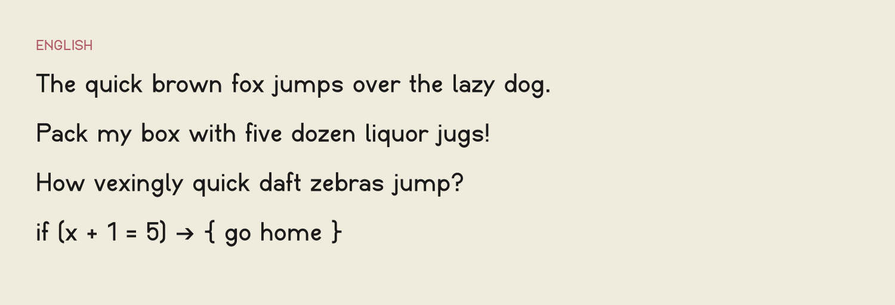
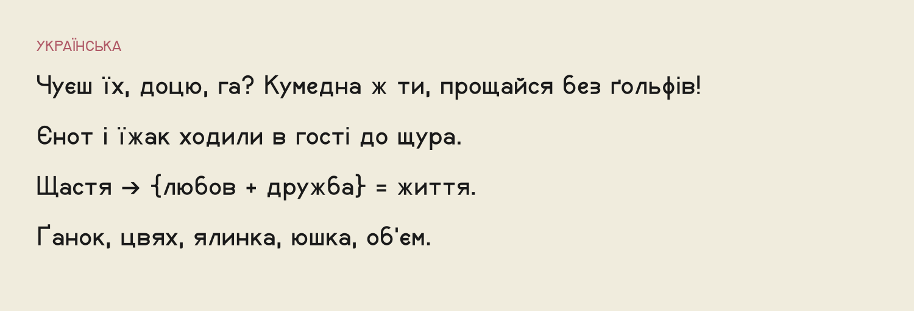
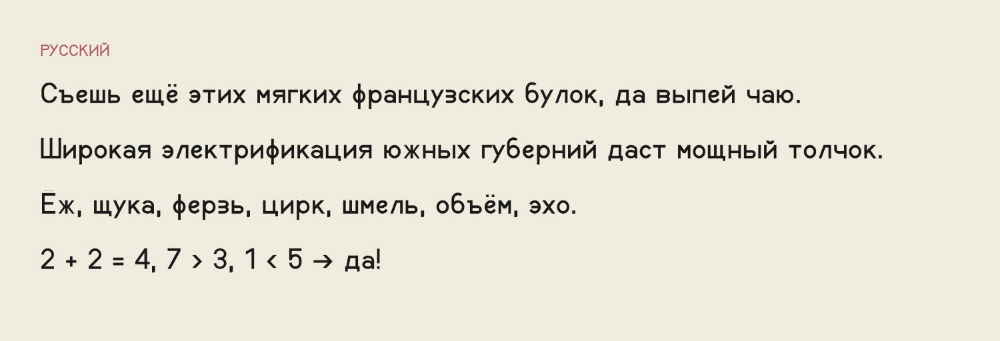
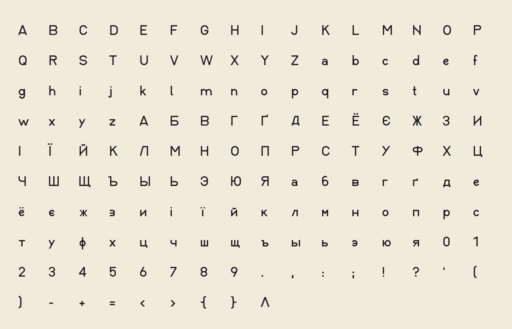

# KVANTUMA 1451

A sans-serif typeface inspired by **DIN 1451**, but constructed entirely from
geometric primitives: circles, ellipses and rectangles.
Supports **Latin** and **Cyrillic**.



## Samples






## Features

- Latin `A–Z a–z`, Ukrainian and Russian Cyrillic (`ґ є і ї`, `ё ъ ы э` included)
- Figures `0–9`
- Punctuation and symbols: `. , : ; ! ? ' ( ) - + = < > { } ^`
- `->` ligature (`liga` and `calt` features)
- Public domain (CC0)

Not (yet) included: `" % / \ | * @ # & _ [ ]`, quotation marks `« »`, dashes, other Cyrillic
languages.

All glyphs:



## Download and install

Ready-to-use files are in [`fonts/`](fonts):

| Format | Path | Use |
| ------ | ---- | --- |
| TrueType | [`fonts/ttf/KVANTUMA1451.ttf`](fonts/ttf/KVANTUMA1451.ttf) | desktop apps, most editors |
| OpenType (CFF) | [`fonts/otf/KVANTUMA1451.otf`](fonts/otf/KVANTUMA1451.otf) | desktop apps, print |
| WOFF2 | [`fonts/woff2/KVANTUMA1451.woff2`](fonts/woff2/KVANTUMA1451.woff2) | web |

Web usage:

```css
@font-face {
  font-family: "KVANTUMA1451";
  src: url("fonts/woff2/KVANTUMA1451.woff2") format("woff2"),
       url("fonts/ttf/KVANTUMA1451.ttf") format("truetype");
}
body { font-family: "KVANTUMA1451", sans-serif; }
```

## Building from source

The master source is [`sources/KVANTUMA1451.sfd`](sources/KVANTUMA1451.sfd) (FontForge).
Each glyph was drawn in Inkscape; the SVGs live in [`sources/glyphs/`](sources/glyphs)
(Latin letters by name, e.g. `a.svg`, Cyrillic by character, e.g. `ж.svg`,
punctuation in caps, e.g. `PLUS.svg`).

Requirements: [FontForge](https://fontforge.org) with Python scripting,
Python 3, ImageMagick and HarfBuzz utils (`hb-view`) (the last two only for images).

```sh
make fonts    # sources/KVANTUMA1451.sfd -> fonts/{ttf,otf,woff2}
make images   # re-render images/*.png from the TTF
make          # both
```

## Design notes

| Metric | Units (em = 1400) |
| ------ | ----------------- |
| Cap height | 800 |
| x-height | 520 |
| Descender | −240 |
| Stroke | 100 |

## Repository layout

```
├── fonts/            built fonts (ttf, otf, woff2)
├── images/           rendered specimens used in this README
├── scripts/          build.py (font generation), render.py (images)
├── sources/
│   ├── KVANTUMA1451.sfd   FontForge master
│   ├── glyphs/            per-glyph SVG drawings
│   └── workspace.svg      Inkscape workspace (grid + guides, work in progress)
├── LICENSE
├── Makefile
└── README.md
```

## License

CC0 1.0 Universal — public domain. See [LICENSE](LICENSE).
